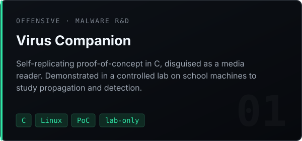
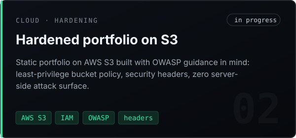
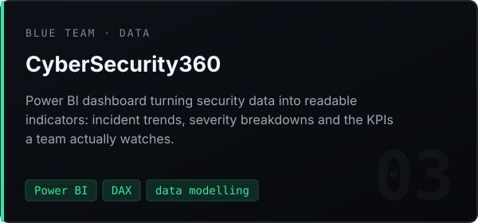
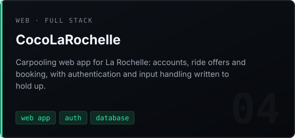
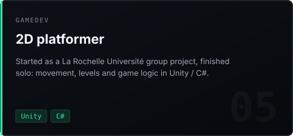

<p align="center">
  
</p>

<p align="center">
  <a href="https://hamlaoui-ilias.vercel.app"></a>
  <a href="https://www.linkedin.com/in/ilias-hamlaoui-15932b3a4"></a>
  <a href="mailto:im.hamlaoui@gmail.com"></a>
</p>

```console
$ whoami
ilias — M1 Cybersecurity @ CRYPTIS, Université de Limoges (prev. 3 yrs La Rochelle Université)

$ cat focus.txt
offensive security · low-level C · securing what I ship

$ grep -i "looking for" status.log
[+] internship / work-study (alternance) in offensive security — France
```



<table>
<tr>
<td width="50%"><a href="https://github.com/mhamlaoui/virus-compagnon"></a></td>
<td width="50%"><a href="https://hamlaoui-ilias.vercel.app"></a></td>
</tr>
<tr>
<td width="50%"><a href="https://github.com/mhamlaoui/CyberSecurity360"></a></td>
<td width="50%"><a href="https://github.com/mhamlaoui/CocoLaRochelle"></a></td>
</tr>
<tr>
<td colspan="2"><a href="https://github.com/mhamlaoui/immersion"></a></td>
</tr>
</table>



<p>
  
  
  
  
  
  
  
  
  
</p>



<p align="center">
  
  
</p>

<p align="center"><sub><code>// all offensive work is done in labs, CTFs, or with explicit authorisation.</code></sub></p>
